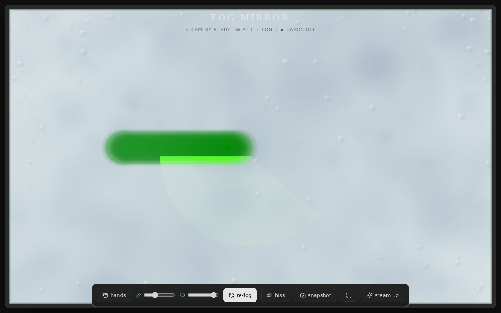

# Fog Mirror

A steamy bathroom mirror in your browser. Wipe the fog with your finger, mouse, or just your hand in the air - and watch it slowly steam back up.

**Live demo: https://fog-mirror-atharv.netlify.app**

## Features

- **Real-time webcam mirror** - your camera, mirrored like a real mirror
- **Photoreal condensation** - 3000+ procedurally drawn droplets with specular highlights, rim shadows and edge build-up
- **Hand tracking** - wipe the fog with a finger in the air (MediaPipe), no touching the screen
- **Water drip physics** - wiped areas occasionally shed drips that run down the glass
- **Slow re-steaming** - fog gradually creeps back, or stays cleared - your choice
- **Synthesized sound** - squeak while wiping (pitch follows your speed), optional steam hiss - pure Web Audio, zero audio files
- **Snapshot** - save a polaroid-style PNG of the mirror
- **Double-tap to steam up**, fullscreen mode, PWA installable (Add to Home Screen)
- Graceful fallbacks - mouse/touch if hand tracking is unavailable, clear camera-permission handling

## Tech

Single self-contained `index.html` - no build step, no backend.

| Piece | Library |
|-------|---------|
| Styling | Tailwind CSS (CDN) |
| Icons | Lucide |
| Hand tracking | MediaPipe Hands + Camera Utils (CDN) |
| Fog engine | HTML5 Canvas, procedural textures, `destination-out` compositing |
| Audio | Web Audio API (synthesized noise) |

## Run it

Open `index.html` in any modern browser - that's it. Camera and hand tracking need HTTPS (or `localhost`).

## Deploy

Any static host works. On Netlify: drag the folder into the dashboard, or deploy `index.html` as the site root.

## Controls

| Control | What it does |
|---------|--------------|
| hands | toggle AI hand tracking / mouse mode |
| brush | wipe radius |
| fog | fog density |
| re-fog | fog slowly returns: on/off |
| hiss | steam sound: on/off |
| snapshot | download polaroid PNG |
| fullscreen | immersive mode |
| steam up | reset the fog |
| double-tap | quick steam up |

