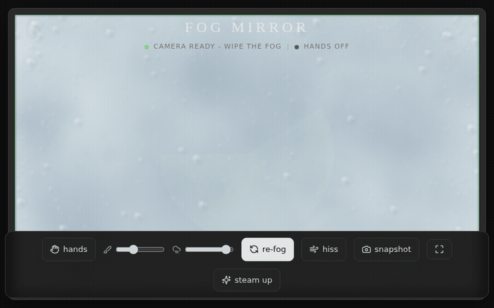
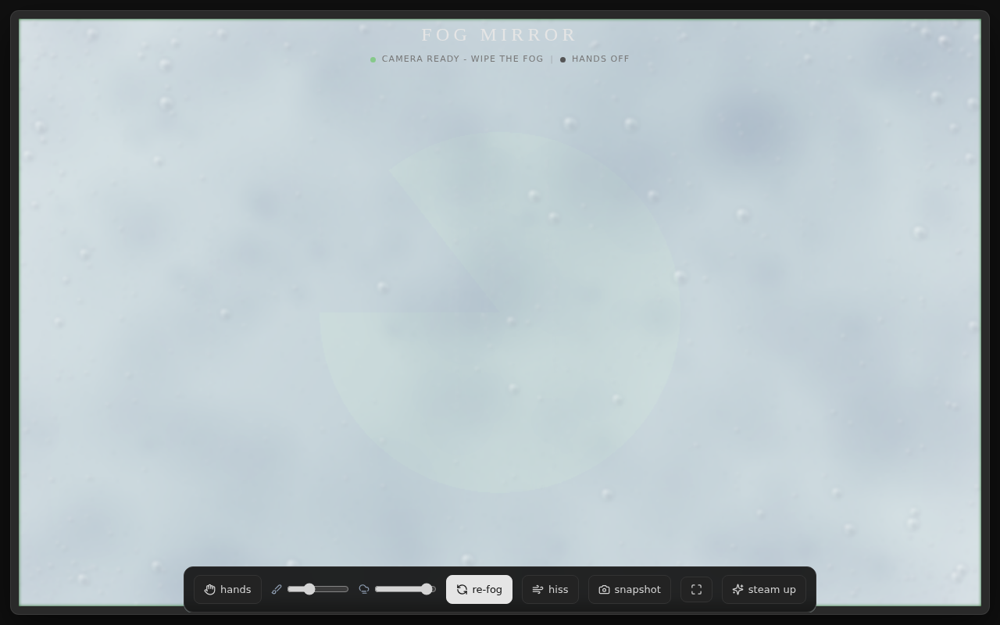
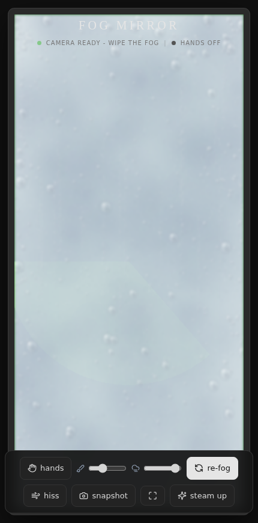

# 🌫️ Fog Mirror

**A steamy bathroom mirror in your browser.**

Wipe the fog with your mouse, your finger, or just your hand in the air.

---

## ✨ Features

| | |
|---|---|
| 🪞 | **Real-time webcam mirror** - your camera, mirrored like a real mirror |
| 💧 | **Photoreal condensation** - 3000+ procedural droplets with specular highlights, rim shadows and edge build-up |
| 🖐️ | **AI hand tracking** - point to wipe precisely, open palm for a big wipe, two hands supported |
| ✊ | **Fist = steam up** - hold a fist for a second and the mirror re-fogs |
| 🩸 | **Water drip physics** - wiped areas shed drips that run down the glass |
| 🌫️ | **Slow re-steaming** - fog gradually creeps back, or stays cleared - your choice |
| 🔊 | **Synthesized sound** - wipe squeak (pitch follows speed) + optional steam hiss, pure Web Audio, zero audio files |
| 📸 | **Snapshot** - download a polaroid-style PNG of the mirror |
| 📱 | **PWA installable** - Add to Home Screen, fullscreen mode, double-tap to steam |

## 🖐️ Hand gestures

| Gesture | Action |
|---------|--------|
| ☝️ Point (index out) | Precise wipe |
| 🖐️ Open palm | Big wipe (2.2x brush) |
| ✊ Fist (hold 1s) | Steam up again |
| 🖐️🖐️ Two hands | Both wipe at once |

Tracking uses One Euro filtering (zero jitter), velocity prediction (zero lag) and distance-scaled brush size.

## 🛠️ Tech

Single self-contained `index.html` - **no build step, no backend, no dependencies to install.**

| Piece | Library |
|-------|---------|
| Styling | Tailwind CSS (CDN) |
| Icons | Lucide |
| Hand tracking | MediaPipe Hands (CDN) |
| Fog engine | HTML5 Canvas - procedural textures, `destination-out` compositing |
| Audio | Web Audio API - synthesized noise |

## 🚀 Run it

Open `index.html` in any modern browser. That's it.

> Camera + hand tracking need HTTPS or `localhost`.

## ☁️ Deploy

Any static host. On Netlify: drag the folder into the dashboard. Done.

## 🎮 Controls

| Control | What it does |
|---------|--------------|
| hands | toggle AI hand tracking / mouse mode |
| brush | wipe radius |
| fog | fog density |
| re-fog | fog slowly returns: on/off |
| hiss | steam sound: on/off |
| snapshot | download polaroid PNG |
| fullscreen | immersive mode |
| steam up | reset the fog |
| double-tap | quick steam up |

**Made with 🌫️ and a webcam**

